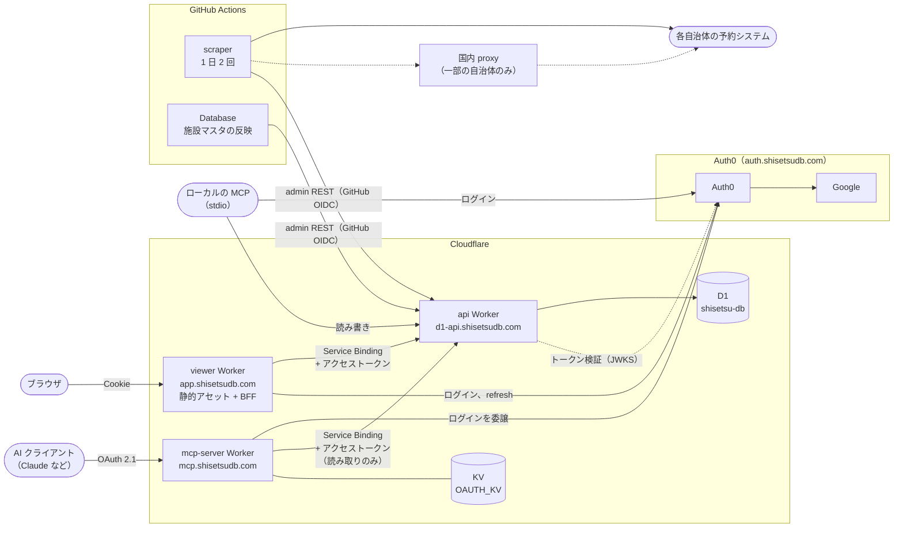

# Shisetsu Viewer

https://app.shisetsudb.com

## はじめに

- このサイトは音楽練習が可能な公共施設の予約状況・施設情報を閲覧するためのものです。

## 機能の説明

### 予約状況検索機能

- 公共施設の予約状況を予約システムから取得し、加工して表示しています。

### 施設情報検索機能

- 公共施設の施設情報をウェブサイトから取得し、加工して表示しています。

## 対応地区

- 荒川区
- 江戸川区
- 大田区
- 北区
- 江東区
- 品川区
- 杉並区（※現在、予約状況が表示できません）
- 墨田区
- 豊島区
- 中央区
- 文京区
- 港区
- 目黒区
- 川崎市

## 備考

- 予約状況検索機能については、管理人の許可制としております。管理人までご連絡ください。
- 表示されている情報に関し、当サイトはいかなる責任も負いません。

## システム構成

- D1 を読み書きするのは api Worker だけです。viewer と mcp-server は api を通して読みます。scraper と Database ワークフローは、GitHub OIDC で認証して api の admin REST に書き込みます。
- 利用者のアカウント情報は Auth0 だけが持ち、D1 には保存しません。ロールとトライアルの別は、Auth0 のアクセストークンのクレームで渡します。
- ブラウザはトークンを持ちません。viewer Worker（BFF）が Auth0 のトークンを暗号化した Cookie に入れ、api へ転送するときにアクセストークンを付けます。
- mcp-server は AI クライアント向けに自分で OAuth のトークンを発行し、Auth0 のトークンは KV に置きます。Workers 版も viewer と同じく Service Binding で api を通して読むだけで、書き込みはローカルの stdio 版が api 経由で行います。
