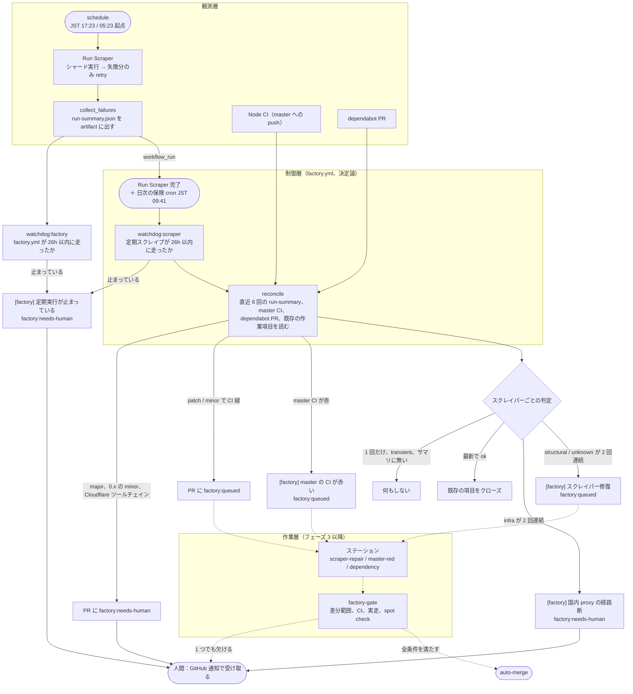
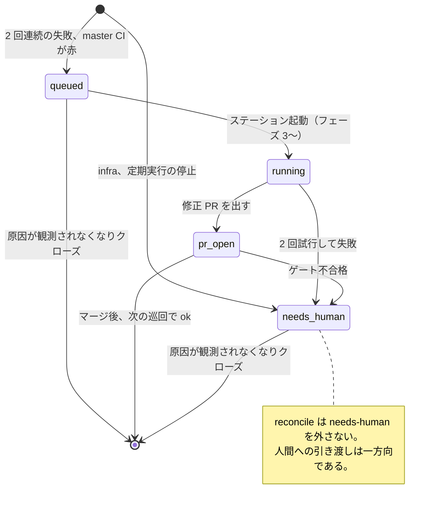

# @shisetsu-viewer/factory

software factory の制御層である。
定期スクレイプの結果、master の CI、dependabot PR を読み、あるべき作業項目と比べて GitHub Issue を維持する。
人間が起動しなくても、維持の仕事が検知から作業項目まで進むようにするのが目的である。

設計は `docs/superpowers/specs/2026-10-04-software-factory-design.md`、実装計画は `docs/superpowers/plans/2026-10-04-software-factory-phase0-2.md` にある。

## 運用フロー

現在は **observe モード**（フェーズ 2）で動いている。
reconcile は作業項目 Issue の作成、更新、クローズと、dependabot PR へのラベル付けまでを行い、エージェントの起動と自動マージはしない。
図の点線は、フェーズ 3 以降で有効にする部分である。



この流れには、要所が三つある。

一つめは、単発の失敗を作業にしないことである。
タイムアウトが structural に分類されても次の定期実行で解消することは多く、2026-10 の kanagawa-kawasaki（#1714、#1718）がその例である。
2 回連続という閾値は、分類器のこの精度不足を時間方向の冗長性で補っている。

二つめは、reconcile がイベントではなく状態に反応することである。
毎回、直近の run-summary と既存の Issue を突き合わせて差分だけを適用するので、何回実行しても結果は変わらない。
ある回の起動を取りこぼしても、次の回が同じ判断を出し直す。

三つめは、人間に届く通知を `factory:needs-human` に絞ることである。
エージェントで直せない経路断（Mac のスリープなど）、人間の判断が要る依存更新、定期実行そのものの停止だけが、所有者への assign として届く。

## 作業項目の状態

作業項目は Issue 1 件で表す。
本文末尾の隠しマーカーに重複排除キー（`<!-- factory:key scraper-repair:tokyo-kita -->`）と状態（`<!-- factory:state {"consecutive":2,"lastRunId":…} -->`）を持つので、Issue を開けば工場の内部状態がそのまま読める。



`factory:hold` は人間が付けるラベルで、reconcile はその項目を作成も編集もクローズもしない。
状態図には描いていないが、どの状態からでも付けられる。

## 止め方

| 粒度 | 手段 | 効果 |
|---|---|---|
| 工場全体 | repo variable `FACTORY_MODE=off` | reconcile も watchdog も何もしない |
| 工場全体 | `FACTORY_MODE=observe`（未設定時の既定） | 作業項目の維持だけを行う |
| 作業項目 | Issue や PR に `factory:hold` | その項目には触らない |

フェーズ 2 では、`FACTORY_MODE=on` も observe として扱う。

## 状態の見方

```bash
gh issue list --label factory --state open
gh pr list --label factory
gh run list --workflow factory.yml --limit 6
```

reconcile の各回のログには、読んだ run-summary の run ID と、適用した操作の JSON が出る。

## 開発

```bash
npm run test -w @shisetsu-viewer/factory
FACTORY_OWNER=trfv node packages/factory/src/cli/reconcile.ts --dry-run
```

判定はすべて `src/*.ts` の純関数にあり、`node --test` で固定している。
2026-10 の実際の run（sumida の preflight 530 の連続、kawasaki の単発の structural）と、滞留していた dependabot PR をフィクスチャに含める。
`src/gh.ts`、`src/applyOps.ts`、`src/cli/` は `gh` を呼ぶだけの薄い層で、単体テストを持たない。
